<!-- Dihasilkan oleh tools/build.py dari data/*.json. Jangan edit langsung: ubah data lalu jalankan build. -->

  

  






  
  
  
  
  
  
  
  
  
  
  
  


<table>
<tr>
<td width="33%" valign="top">
<a href="https://dicoding-milestone-fruch.vercel.app/"></a>

<a href="https://dicoding-milestone-fruch.vercel.app/">▸ LIVE DEMO</a>

</td>
<td width="33%" valign="top">
<a href="https://nathdicodingstory.netlify.app/"></a>

<a href="https://nathdicodingstory.netlify.app/">▸ LIVE DEMO</a>

</td>
<td width="33%" valign="top">
<a href="https://sipolubogo.cartera.my.id/"></a>

<a href="https://sipolubogo.cartera.my.id/">▸ LIVE DEMO</a>

</td>
</tr>
</table>



<code>&gt; DATA STREAM // contribution snake · auto-update via GitHub Actions</code>

  



<b>ACCESS CERTIFICATES [09]</b> · klik untuk membuka

 

<ul>
<li><a href="https://www.dicoding.com/certificates/72ZD5MK9VZYW">Memulai Dasar Pemrograman untuk Menjadi Pengembang Software</a> · <code>2025-02-15</code></li>
<li><a href="https://www.dicoding.com/certificates/ERZRE720MXYV">Pengenalan ke Logika Pemrograman (Programming Logic 101)</a> · <code>2025-02-15</code></li>
<li><a href="https://www.dicoding.com/certificates/0LZ0RJ51KP65">Belajar Dasar Git dengan GitHub</a> · <code>2025-02-16</code></li>
<li><a href="https://www.dicoding.com/certificates/NVP75WJ1RXR0">Belajar Dasar Pemrograman Web</a> · <code>2025-02-24</code></li>
<li><a href="https://www.dicoding.com/certificates/ERZRE3KLQXYV">Belajar Dasar Pemrograman JavaScript</a> · <code>2025-03-08</code></li>
<li><a href="https://www.dicoding.com/certificates/MEPJQ3G24X3V">Belajar Membuat Front-End Web untuk Pemula</a> · <code>2025-03-21</code></li>
<li><a href="https://www.dicoding.com/certificates/ERZREJR62XYV">Belajar Fundamental Front-End Web Development</a> · <code>2025-04-17</code></li>
<li><a href="https://www.dicoding.com/certificates/JLX19M1MNP72">Belajar Back-End Pemula dengan JavaScript</a> · <code>2025-05-16</code></li>
<li><a href="https://www.dicoding.com/certificates/2VX3KQ6VJXYQ">Belajar Pengembangan Web Intermediate</a> · <code>2025-05-19</code></li>
</ul>



  <a href="https://www.linkedin.com/in/nikolaus-ray-nathan/"></a>
  
  

